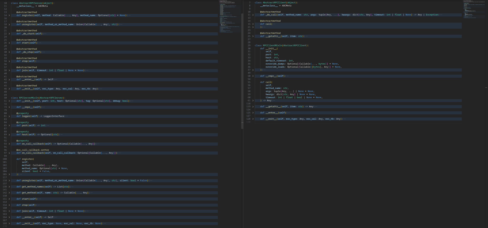

So at [work](https://ftpsolutions.com.au/) we build a product that's geared around scraping and visualising all manner of data sources for mining customers in near real time.

Anything from fleet management databases, APIs, solar controllers and other power systems, routers, switches, LTE devices, backhaul radios, mesh radios, devices on vehicles etc.

There are a lot of things to scrape per customer instance and a lot of different supported integrations.

For better or worse, Python is the language that does a lot of the scraping work- partially because when we started out and it was just me, the (now) CTO and one of the other founders, Python was
the only language I was halfway competent in (having done a fair bit of it while working at a mining company prior).

# Learning on the job

By the time we had got to customer number 4 (2017-ish?), we were really starting to feel the squeeze with Python to the point that for the architectural choices I'd made, I simply could not
fit the amount of concurrent work I needed to do inside a single Python process.

In true startup form though, this didn't happen slowly with time to respond to it- no, it happened right as we were going live at scale for this customer (having spent a week or two writing
integrations for their bespoke hardware).

This necessitated the first (and very brief) version of our multi-processing story: [Celery](https://docs.celeryq.dev/en/stable/getting-started/introduction.html).

It didn't really stick and I'm not sure why; in hindsight, I think I should have tried harder to make it work, but the fact was we'd built the system around having everything in the same process
(for a given integration) and so it wasn't really designed in terms of serializable jobs / tasks and serializable results and we had to really jam Celery support into the system just to get the
pain to stop for this new large customer (at the cost of that customer missing out on some features that other, standardised integrations got "for free").

# Retaining the cake

The system was already quite complicated, I didn't want to add more complexity around serializable tasks and queues and results down at the per-device scraping level (we already had a result queue
for the all-of-this-integration level) and already we had built numerous well-used features that relied on various parts of the hierarchy of stuff inside an integration calling back and forth to
know what to do.

I theorised that there had to be a way to build an RPC system so transparent you hardly knew you were using it; thanks to Python, this was fairly easy, but there were quite a few iterations
before I got it all humming (iterations that had to go all the way to prod to highlight their shortfalls).

# Attempt 1 - JSON-RPC via TCP

Even this early in my career, I was no stranger to computer networking; I had been programming at a hobby level since I was a kid and I had just come off the back of 9-odd years in the Australian
Army as a telecommunications technician, so I understood TCP- it shouldn't be too hard, I've written toy multi-threaded TCP chat servers before.

Well, I hadn't written robust software expected to run forever on remote machines and I hadn't learned all the stuff you have to learn about that (fortunately it was coming, and real soon).

Things like timeouts, deadlines, blocking vs non-blocking sockets, the streaming nature of a TCP socket (why did this read see two messages?! what is framing?!) and a whole bunch of fun stuff about
concurrency.

In short, I couldn't get the low-level part working reliably at that point in my career, and so I gave up.

# Attempt 2 - JSON-RPC via [gRPC](https://grpc.io/docs/languages/python/quickstart/)

Hang on, JSON-RPC via gRPC? You know gRPC has its own types right? And services and stuff?

Yes, I did know, but it's tedious and I needed something generic- I didn't yet know exactly what calls I'd need to make and I didn't want to have to think about it, so I kept the JSON-RPC
approach of the first attempt because I knew that sort of worked (it was just the networking side that wasn't robust enough for production).

Well it largely worked and we ran it in production for a while (and I think the JSON-RPC part had become a shell merely carried pickled Python data by this point) but the problem was it was slow and heavy.

Enough such that I had to come up with something else; the overhead of splitting work off for a large instance of an integration into n \* processes that you could transparently call in and out of as if they
were "right there" using gRPC was simply too much- you'd go from a single Python process that was tapped at 100% of a CPU core, only _just_ failing to get it's work done to 5 Python processes all asking way too
much of the server they're on, just for the privilege of communicating with each other.

It had to go.

# Attempt 3 - Generalization for JSON-RPC via [MessagePack-RPC](https://github.com/studio-ousia/mprpc)

By this point I had an inkling that my next attempt would not be my last attempt, and so I took the time to build some generalized abstractions that I'm frankly quite proud of (and it's still in use today):

So most of the batteries of an RPC server and client existed at this common layer; to implement it, you only had to provide something that send a method name, arguments and keyword arguments some place
and you had to provide something could receive that- the common layer handled the actual registration of callable methods and fed the return value back to the thing you provided.

I built some higher layers as well that were a fair bit more complicated- the `RPCServer` / `RPCClient` stuff was merely the fundamentals; it was followed by `RPCBrokerServer` and `RPCBrokerClient` which
themselves were simply instances of `RPCServer` and `RPCClient` with special roles around announcing any `RPCServers` you had and receiving announcements for remote `RPCServers`.

To pour some sugar on it for ease of use, I built the `RPCDuplex` (I'm not good at names) that bundles it all together and gives you a single place to quickly vend an `RPCClient` for a remote `RPCServer` as
well as expose any local methods you want remote `RPCDuplex` instances to be able to call (all in a user-friendly way).

It didn't stop there though, this was all just at the method level; really what I wanted was remote objects!

Well, that's exactly where it went, I built `InstanceRouter` for announcing and receiving announcements about `InstanceManagers` which themselves exposed the means to create `Instances` (which were just instances
of a predefined type whitelist of Python classes) which were called using an `InstanceClient`; but this still wasn't enough, the `InstanceClient` interface was horrific- you had to create all the `RPCDuplex` fruit
above only to finally call your `InstanceClient` with something like `.call(class_name, method_name, *args, **kwargs)` (talk about bad DX).

So the final cherry on top was deep lesson in `__getattr__` and `__getattribute__` (if you know, you know) as I created the `InstanceClientWrappedInstance`.

Jesus Christ Ed, what the hell was it? I'm glad you asked.

It's just an object proxy, the most transparent object proxy you've ever seen, it quacks entirely like the object at the other end of the wire, potentially on a completely different machine.

You wanna call a method? Done. You wanna get the value of a property? Done. You wanna set a new property? Done. Your property is actually a getter? Not an issue.

Your object isn't picklable? Okay well that was an issue, at first, until I learned an additional deep lesson on `__getstate__` and `__setstate__`.

It felt like magic- it was I guess, a little too magic; but it was a great deal of fun to write.

Anyway, once I'd built all that and ported the gRPC implementation to it, adding the MessagePack-RPC implementation was trivial.

Too bad it didn't work! I don't even remember what it was, some fatal flaw in MessagePack-RPC that just didn't work for us, something about threading? I can't remember.

It was a shame in my isolated (and not multi-threaded) test it was _much_ faster than the gRPC implementation.

Anyway, the [(now) CTO](https://www.linkedin.com/in/scott-mills-4078655b/) found a rather interesting looking library that I had not heard off...

## Attempt 4 - [Pyro4](https://pyro4.readthedocs.io/en/stable/)

It looked very interesting, I tested it out- it was fast!

I wasted no time at all getting it implemented, learning a few of the sharp edges it had- boy did it have a lot of features.

It's got service discovery! It's got transparent serialization using any pickling approach you want, it's got an easy decorator for exposing objects!

Hang on... It's got all the stuff I spent all that time building...

Anyway, it wasn't too big a deal- I had to dilute the abstraction a bit, have a few flags to walk past a few pieces and use the native Pyro4 stuff instead.

Somewhere around here we lost the JSON-RPC side of things too and the lowest level of the RPC abstraction was mostly a poor example of using the Pyro4 features.

Pour one out for the gRPC and MessagePack-RPC implementations long-gone from the codebase; their echoes remain, whenever somebody needs to make an RPC call they pleasantly confused with seemingly needless
layers of abstraction that once had the valuable purpose of allowing me to go fast while trying out different RPC libraries before finding The One.

Despite all that though, it absolutely hummed once we got it into production and it has been humming ever since.
