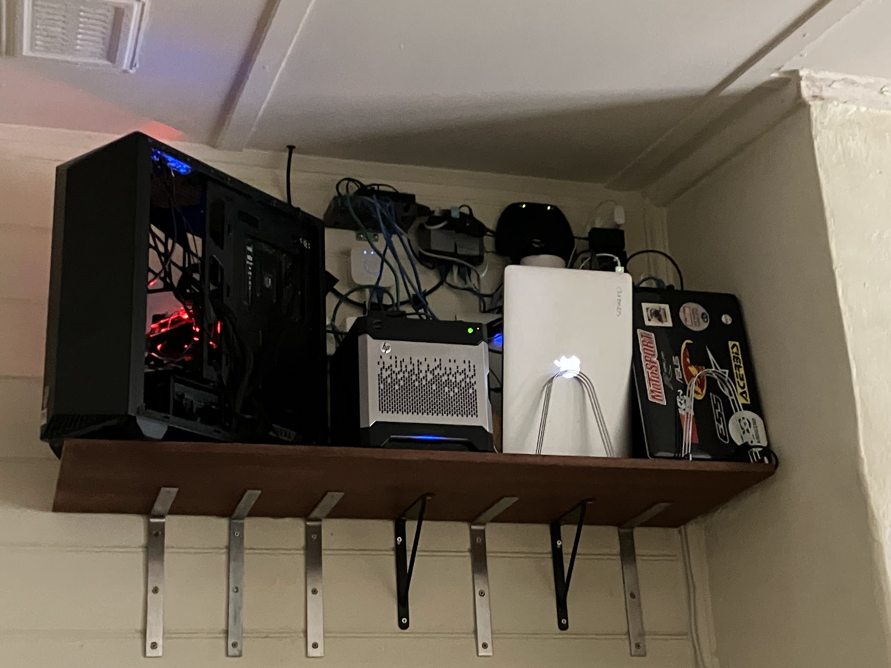
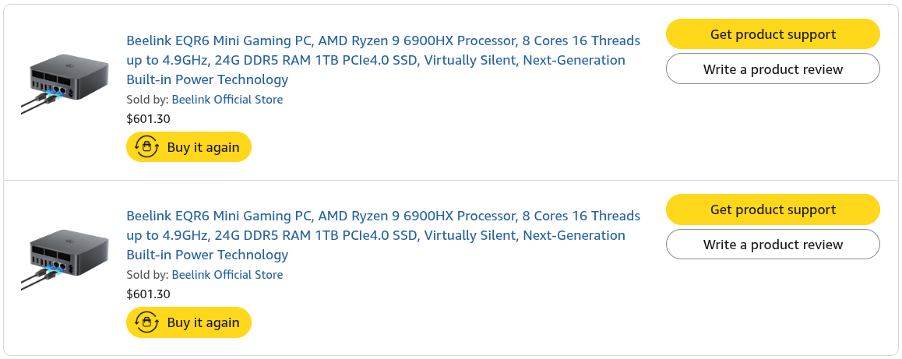
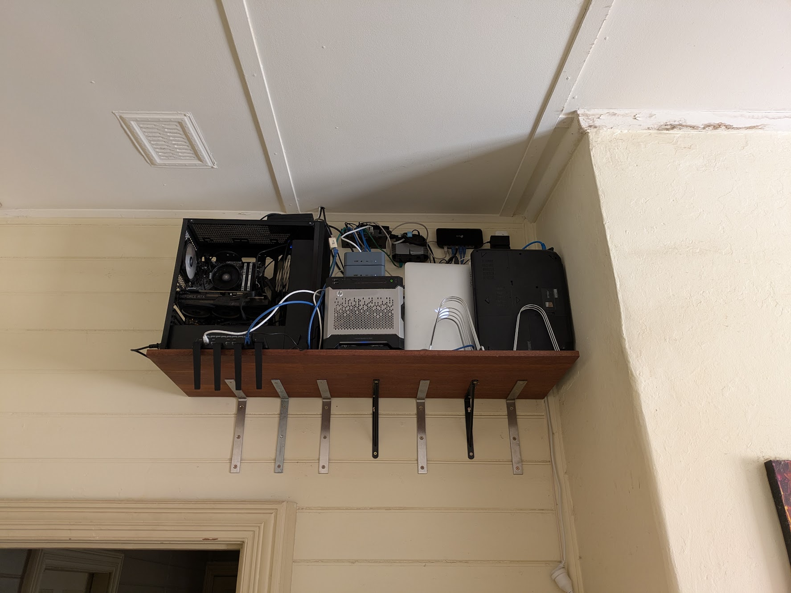
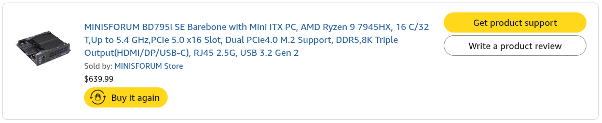
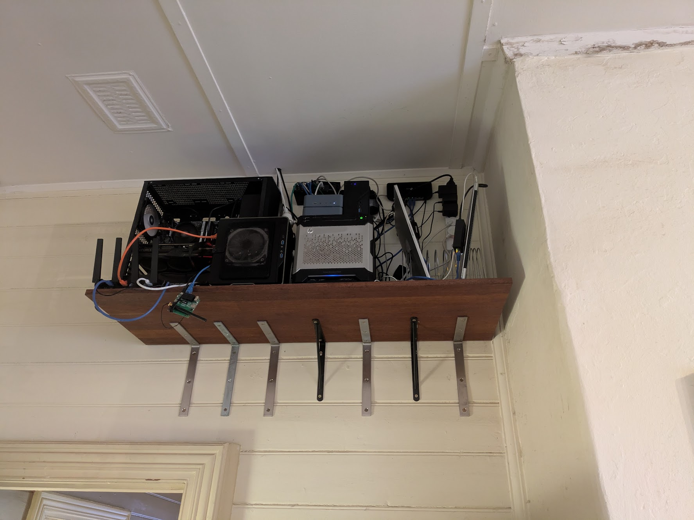

So in 2022 I was carrying on about [permacomputing](/posts/permacomputing) and [my various efforts](an-update-on-the-ghettowulf-cluster) to use all the old hardware I had laying around
for something useful.

I stuck to this fairly well and even offered up my gaming PC (which I wasn't using) until the GPU died (not happy with running YOLO around the clock for my cameras apparently).

But unfortunately (for me) [one of my coworkers](https://www.linkedin.com/in/murray-watts-b4a025159/) had a habit of accidentally capitalising on my FOMO by posting any of the neat technology
purchases he made.

So, I couldn't stop myself being sucked into these:

They soon made their way onto the shelf of course:

And I definitely couldn't avoid this one:

Which helped to displace the oldest two of the four laptop nodes, thinning things out a bit:

I think the [Beelink EQR6s](https://www.bee-link.com/products/beelink-eqr6?variant=48834372042994) turned up ready to go, but I had to buy a few more parts for the
[Minisforum BD795i SE](https://www.minisforum.com/products/minisforum-bd795i-se) (case, RAM, NVMe SSD) and I think the total landed at a bit over $1000 AUD.

Somewhere around this time I also upgraded from the RTX2060 (that died) to an RTX2080 that I bought from a coworker who was getting out of crypto mining.

Everything is just baremetal K3s on Ubuntu 22.04 at this point; I've been trying to get [KubeVirt](https://kubevirt.io/) going but it is a real dog.

I think I probably need to stick with tried-and-true K8s in VMs, not VMs in K8s (despite how nice the idea of declarative VMs as Kube resources sounds).
