For any who read [Sawing My Entertainment Unit In Two](/posts/sawing-my-entertainment-unit-in-two.md), a keen observer might have summised that I'm not very handy.

This is a correct observation, I am not handy at all- but I'm usually willing to have a crack at something if the alternatives are "pay somebody else a lot of money" or "just suffer with it".

This happens to be the situation we found ourselves in for our sad old deck:

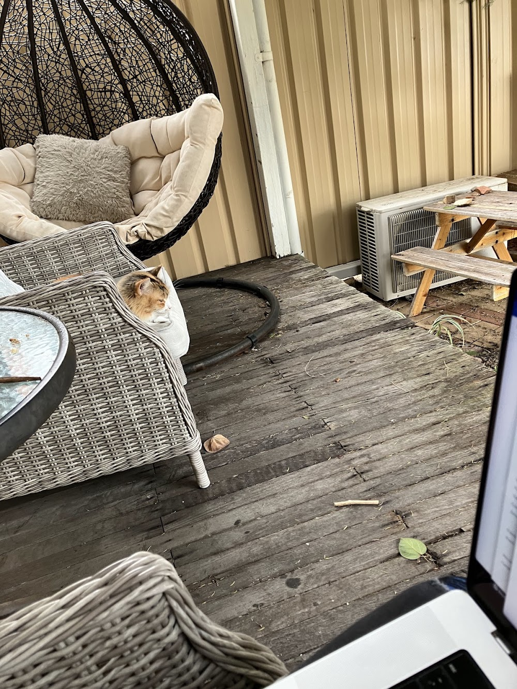

But before we get into that, some adjacent photos provide a quick detour into Augie's first computer (one of the oldest 2 laptops that got removed the cluster):

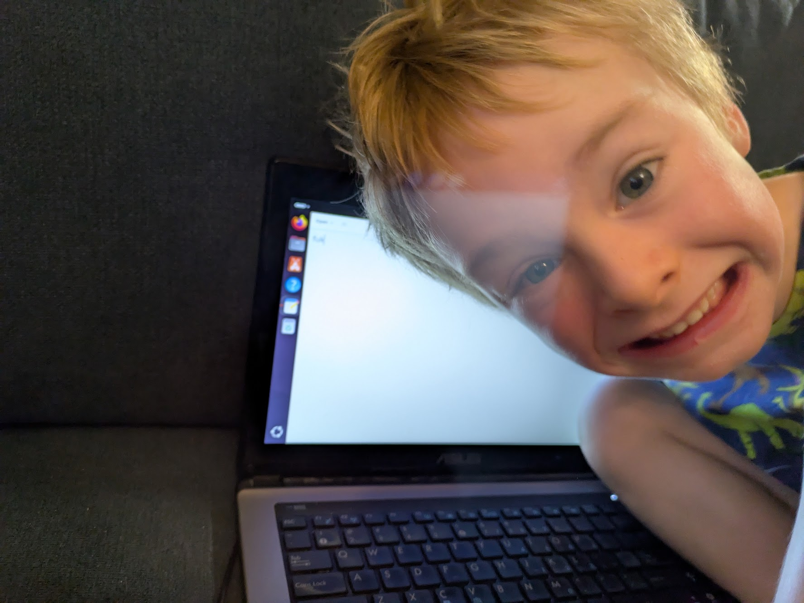

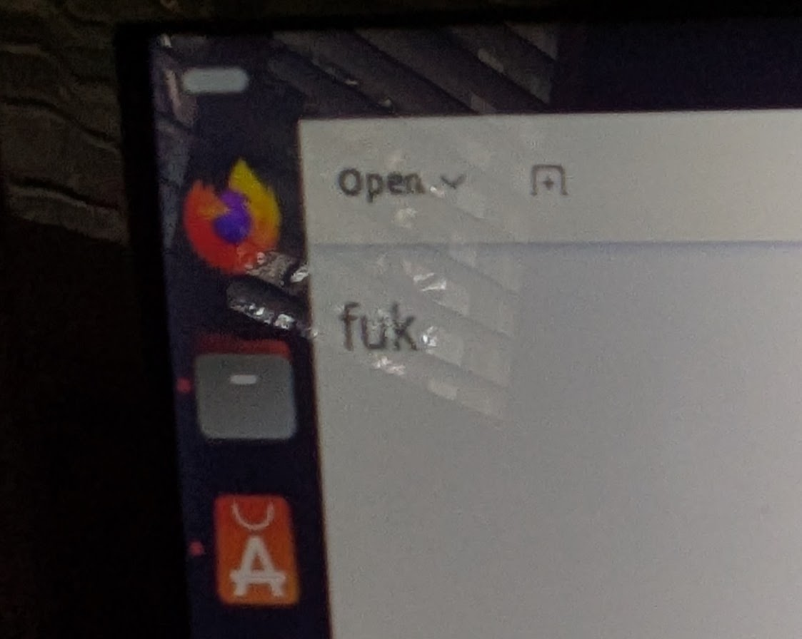

Like father, like son- anyway, I didn't really take enough photos of the removing the old decking and apparently I dove headfirst into replacing joists:

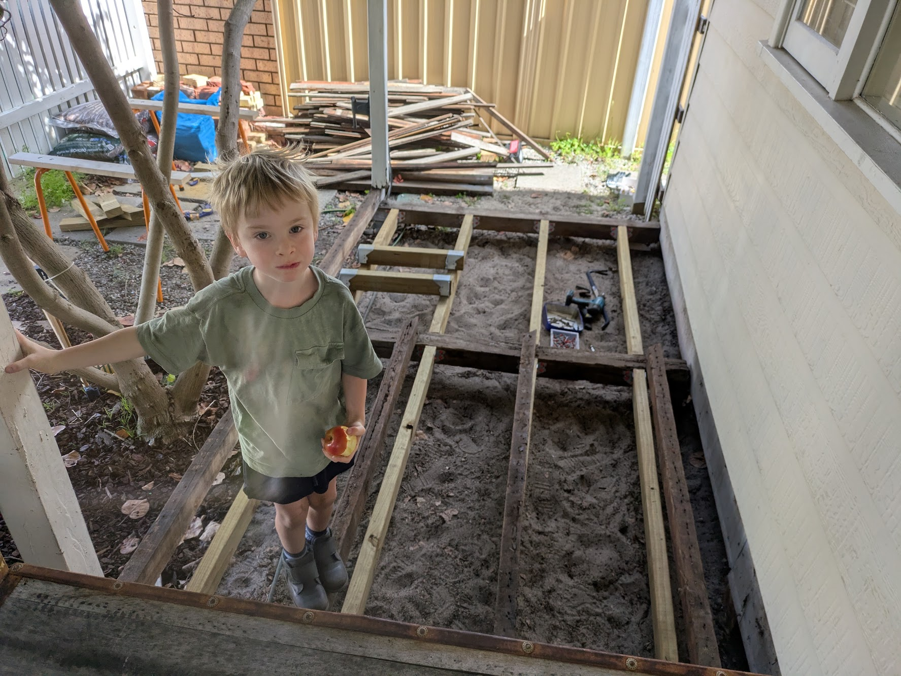

And I don't even know what they're called when you lay them across like this- still joists?

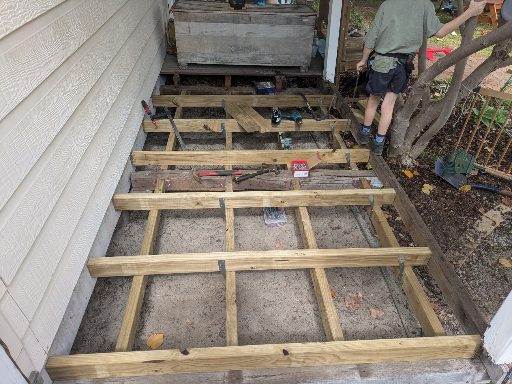

Two sides progressing well:

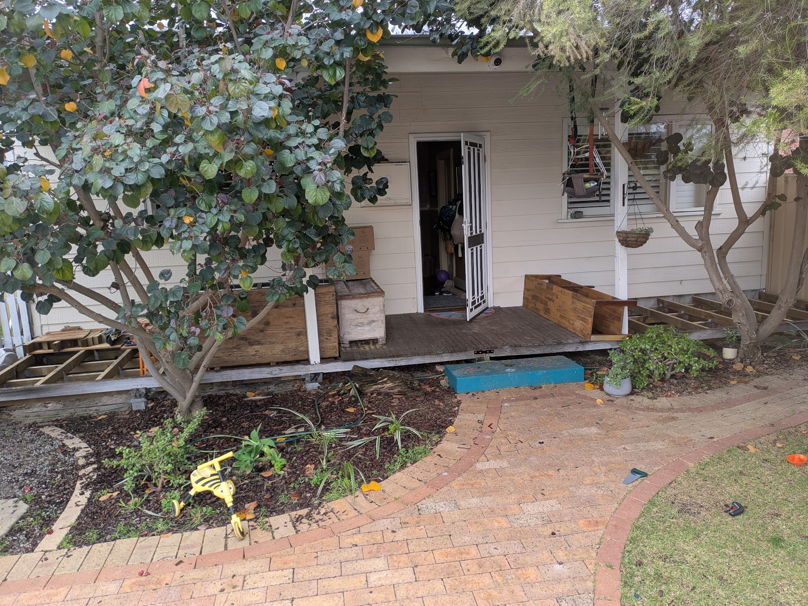

Entire thing ready to have the boards fitted:

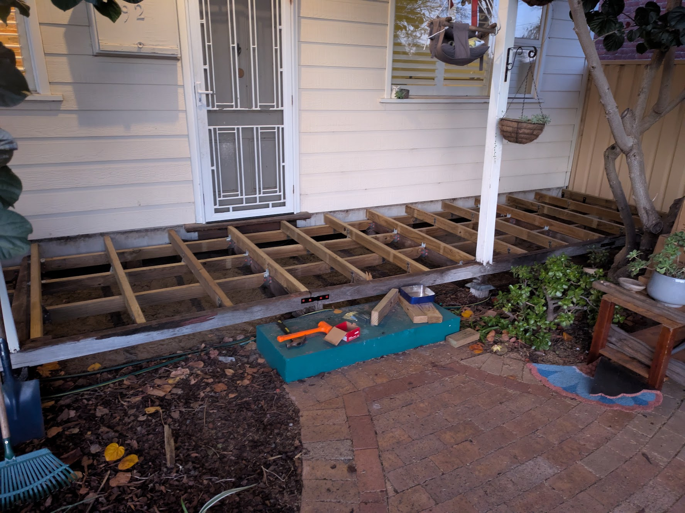

I know this looks unorthodox but I was (correctly as it turns out) anticipating that if I can minimise the amount of cutting I need to do I'll get a better result (for me, with my lack of skill
with a circular saw):

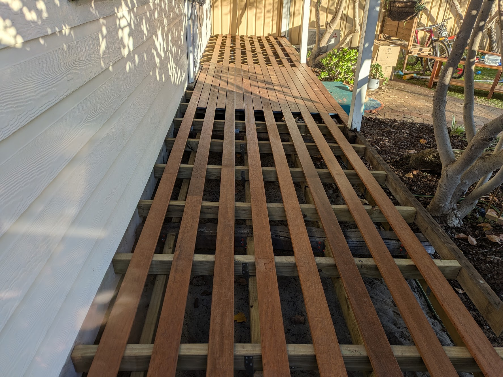

I was a little worried early on about how much the boards had a natural (and varying) warp to them:

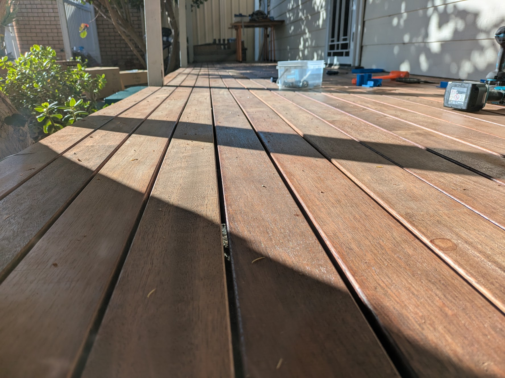

But once I started working through the deck screws, it was easy enough to straight them up:

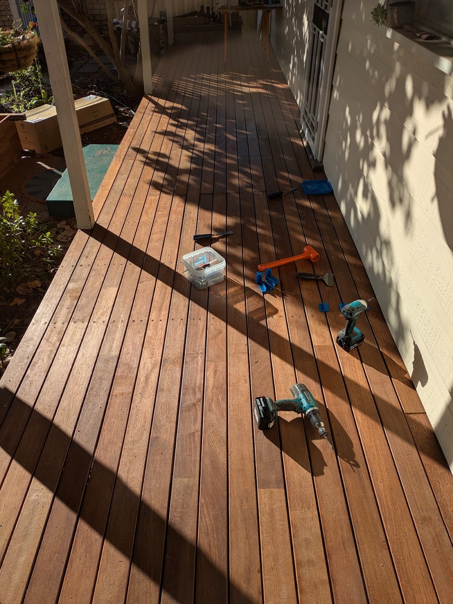

Close to finished here; at the last minute I decided I was going to build some kind of flashing on the front using the remaining boards:

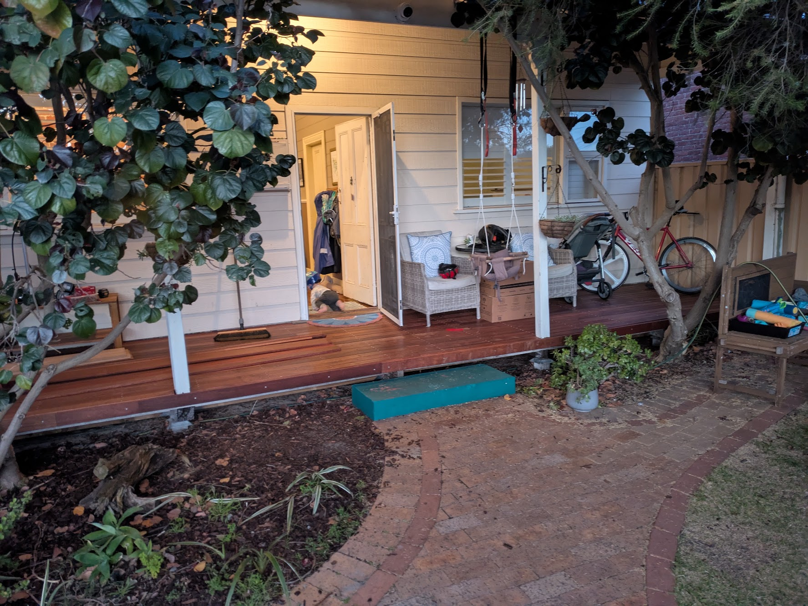

It was eventually complete; I think it ended up taking almost a month of only weekends:

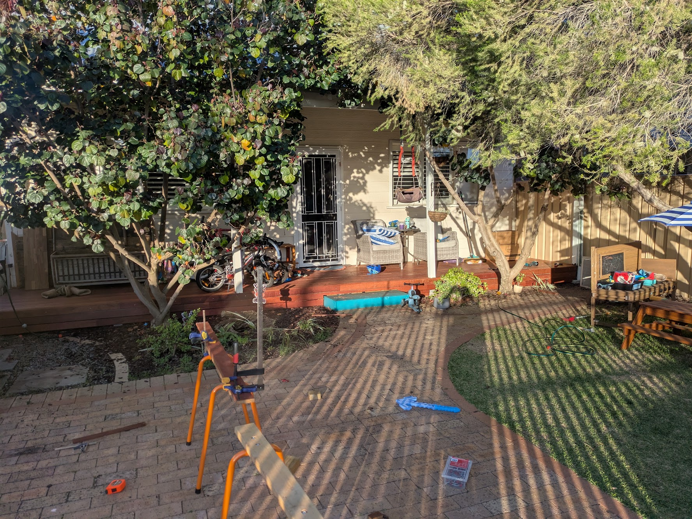
