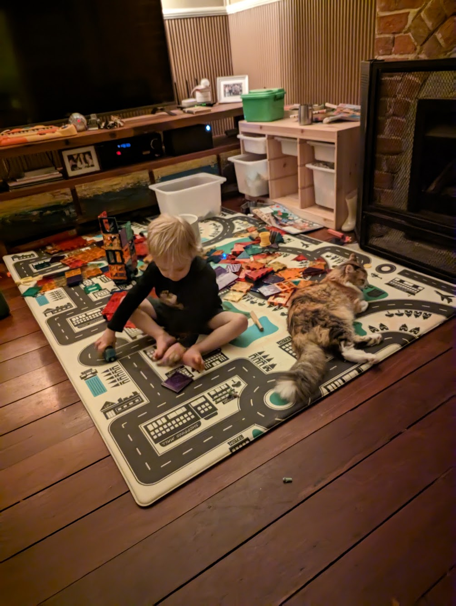
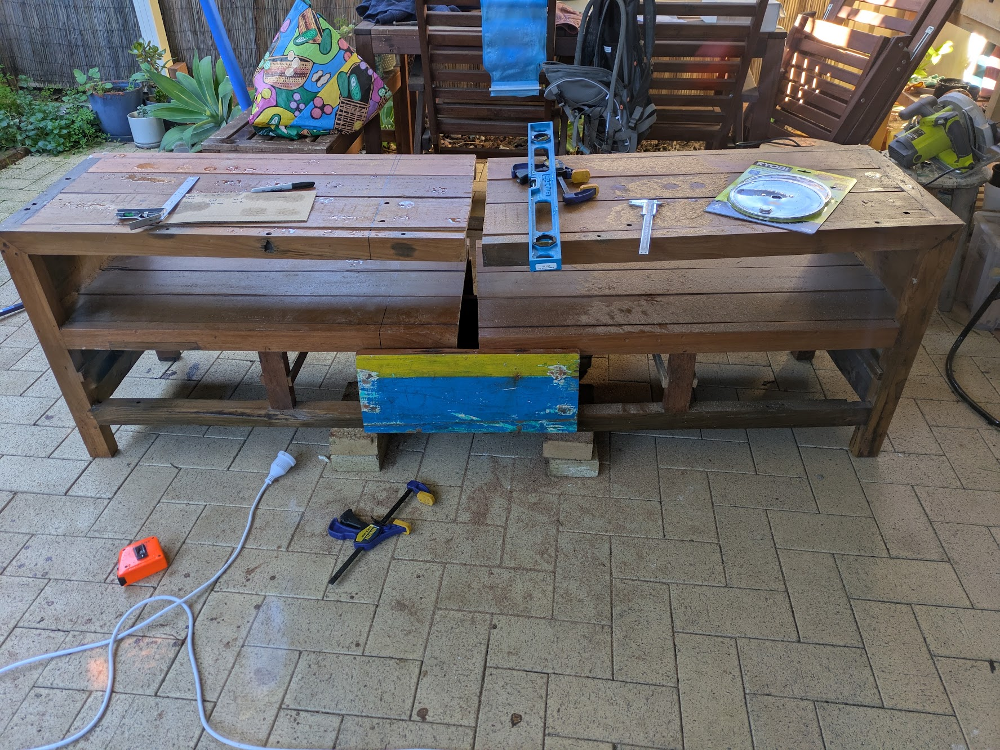
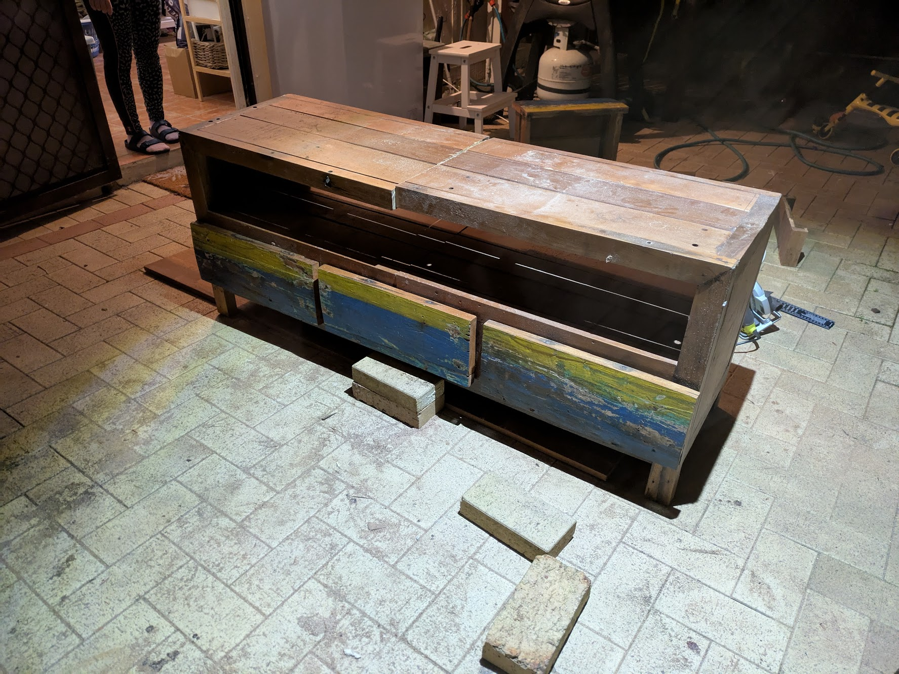
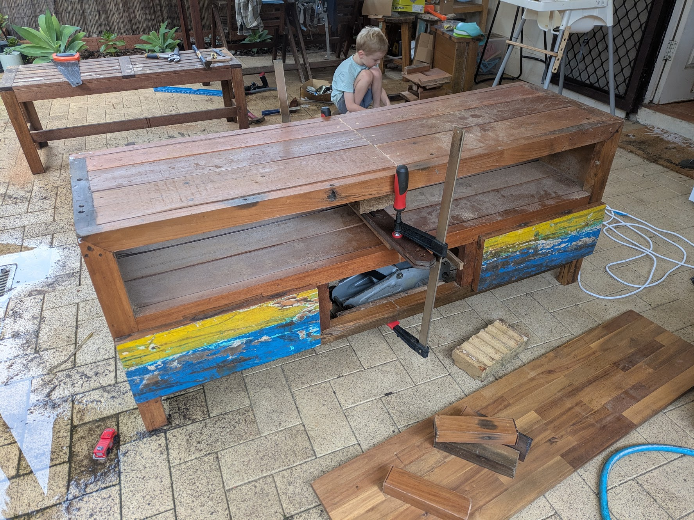
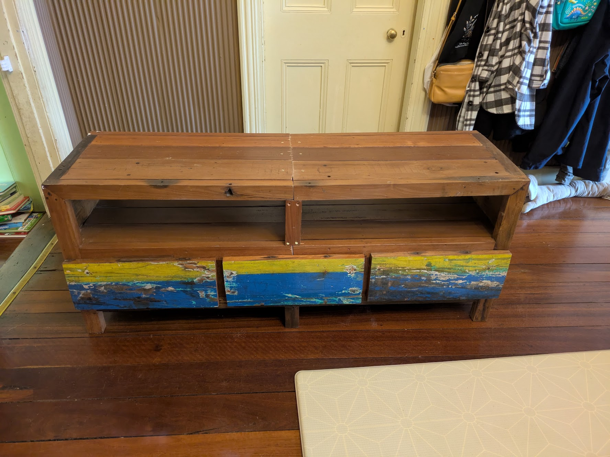
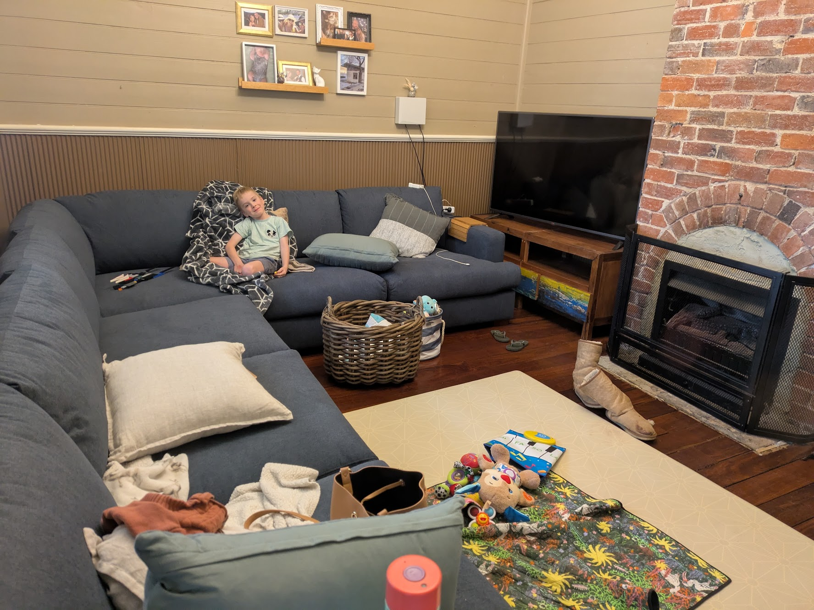
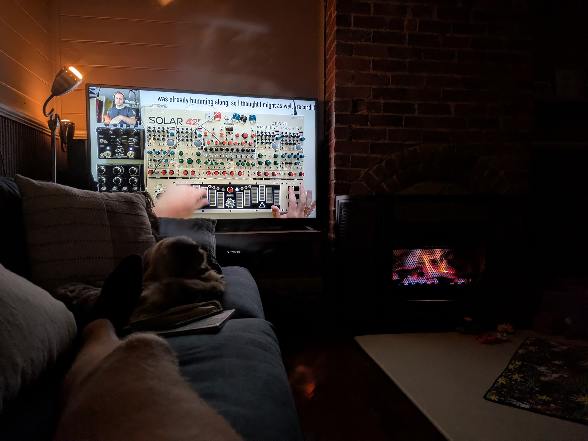

This article is literally what it sounds like.

We finally bought a new couch and had to shuffle our living room around a bit. Well, a lot- frankly it was too large.

One thing we were stuck on was our current TV cabinet (which is fairly long):

I can't find a better before shot (and I didn't think to take one), but the main point to note is that it has four drawers.

I theorized that if I could simply "remove" a single drawer, I'd be able to fit it nicely into the corner of the room, between the wall and the fireplace.

So that's what I set about doing:

It didn't look _too_ bad when mocked up:

Getting it knitted together was a real pain in the neck, I was glad I went with my gut all those years and never threw out any decent looking wood I came across (because that's what's being used
to provide hidden structure across the cut sections):

It's far from perfect, but it's not too obvious thanks to its pre-existing "slapped together" finish:

Much less noticeable once the TV is on it:

And not noticeable at all when used for its primary purpose:

